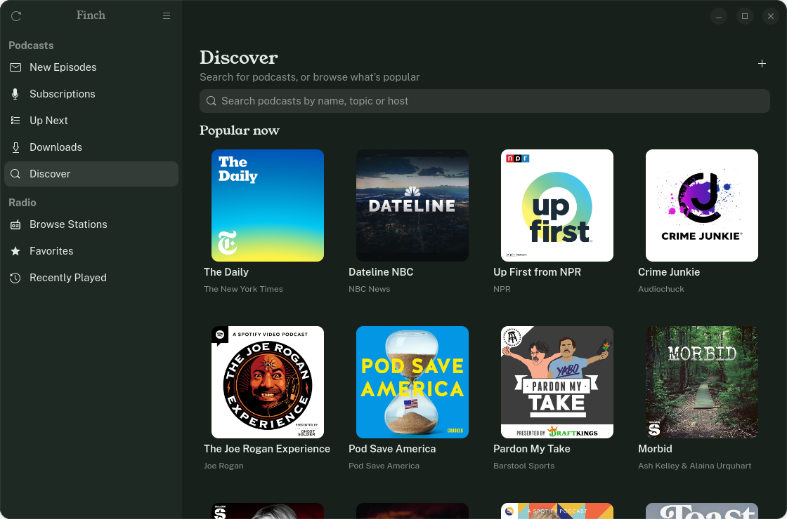
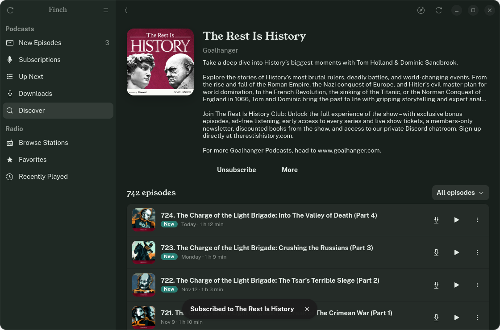
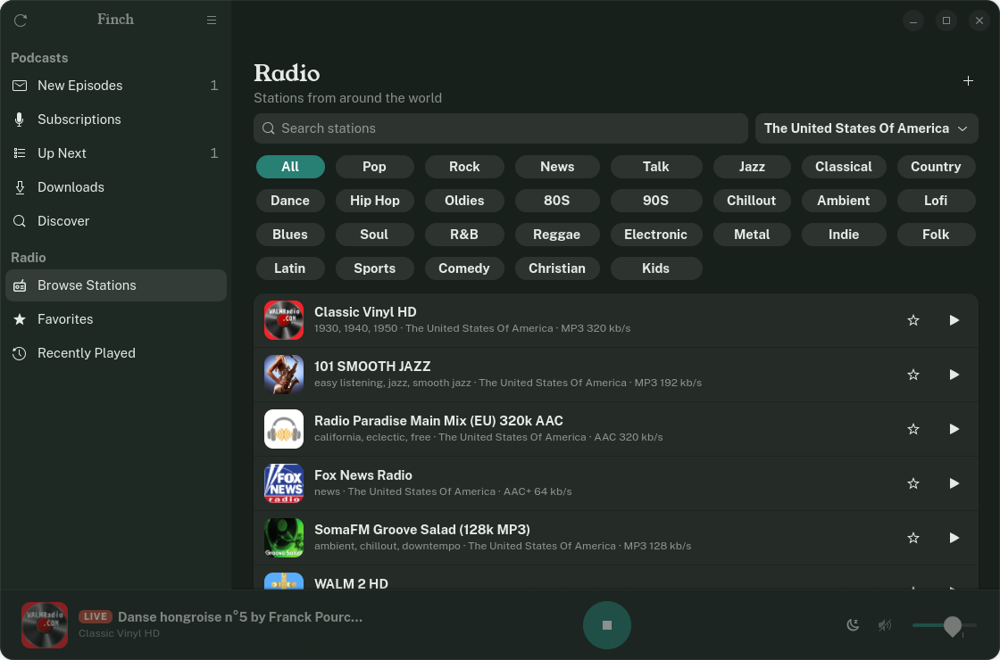

# Finch

*Part of the Sedge family of webhookstudios apps.*

Podcasts and internet radio for Linux, in one place. Find shows, follow them, and get every new episode in one list. Or tune in to radio stations from around the world.



## Podcasts

- **Discover** popular shows, or search by name, topic or host. You can also paste any show's RSS feed address.
- **Subscribe** to get new episodes in **New Episodes**. Finch checks for new ones on its own (every 6 hours by default; you can change this).
- **Up Next:** line up episodes to play one after another.
- **Downloads:** save episodes to listen offline. Finch can download the newest episodes for you, and delete them once they're played.
- **Listening:** pick up where you left off, skip back 15 and forward 30 seconds (both adjustable), play at 0.5× to 3× with voices at their normal pitch, and set a sleep timer.
- **Show notes** for every episode, and filters for episodes you haven't played or have downloaded.
- **Import and export** your subscriptions as OPML, so you can move them to or from other podcast apps.



## Radio

- Browse thousands of stations by **country** and **genre**, or search by name.
- **Star** stations to keep them in **Favorites**; the ones you play show up in **Recently Played**.
- See the **song or programme** that's on now, when the station sends it.
- Add any station by its stream address, including `.pls` and `.m3u` links.



## Make it your own

Twelve color themes (Sedge, Ember, Lantern, Midnight, Moss, Dusk, Slate, Meadow, Sky, Blossom, Driftwood and Birch), ten accent colors, and light or dark. Pick them right at the top of the main menu, or in Preferences.

Media keys and the system's media controls work too.

## Where shows and stations come from

- Podcast search and the popular list come from Apple's public podcast directory. No account is needed. Episodes always come straight from each show's own feed.
- Stations come from [Radio Browser](https://www.radio-browser.info), an open directory kept by volunteers. When you play a station, Finch tells Radio Browser, which keeps its popular lists useful.

## Requirements

- Ubuntu 24.04 or newer with GNOME (GTK 4, libadwaita 1.8 or newer)
- GStreamer with the good plugins (`gstreamer1.0-libav` is recommended for more formats)

Finch has only been tested on Ubuntu 26.04 with GNOME 50.

## Install

### With the deb package (recommended)

Download `finch-player_1.0.0_all.deb` from the [latest release](https://github.com/webhookstudios/finch/releases/latest), then install it:

```bash
sudo apt install ./finch-player_1.0.0_all.deb
```

The package and the command are called `finch-player`, because Ubuntu already has an unrelated program named `finch`.

To remove it:

```bash
sudo apt remove finch-player
```

### From source

```bash
git clone https://github.com/webhookstudios/finch.git
```

```bash
cd finch && PYTHONPATH=. python3 -m finch
```

`./install.sh` adds a menu entry that runs Finch from the cloned folder.

## Keys

| Key | Does |
| --- | --- |
| Space | Play or pause |
| Left / Right | Skip back or forward |
| Ctrl+F | Search |
| Ctrl+R | Check for new episodes |
| Ctrl+N | Add a podcast by its address |

## Your data

- Settings: `~/.config/finch/settings.json`
- Subscriptions, progress, Up Next and stations: `~/.local/share/finch/library.json`
- Downloads: `~/.local/share/finch/episodes/` (you can pick another folder)
- Artwork cache: `~/.cache/finch/art/`

## Tests

`tests/ui.py` drives the real window against the live directories, with sound muted and throwaway folders:

```bash
python3 tests/ui.py [SCREENSHOT_FOLDER]
```

## License

GPL-2.0-or-later. The Young Serif and Public Sans fonts are under the SIL Open Font License.
